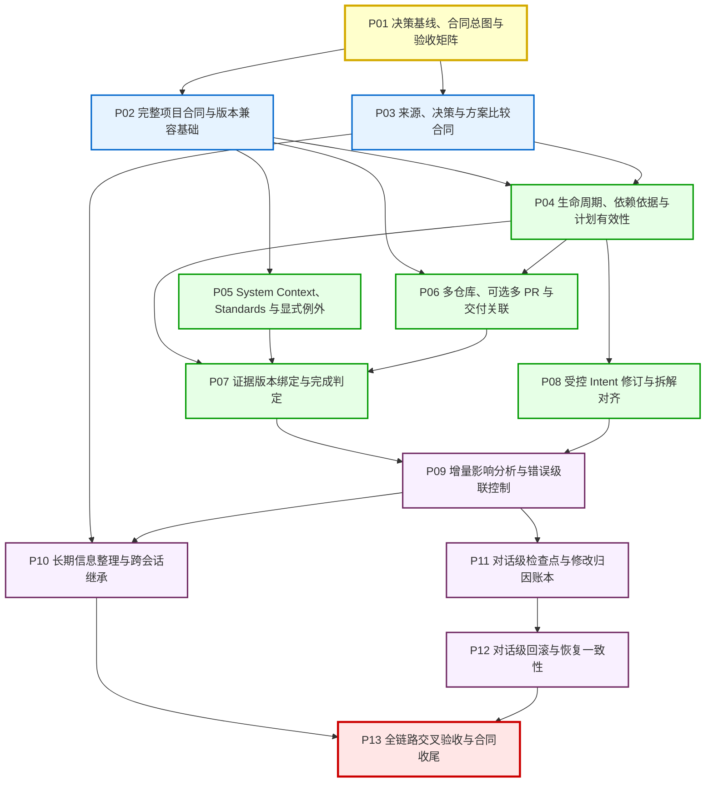

# AgentHub JSON Schema 完善路线图与验收矩阵

文档状态：**P01 已收尾（P01-R3 独立复核通过）**\
基线日期：**2026-10-30**\
当前阶段：**P01 决策基线、合同总图与验收矩阵（独立收尾复核通过；P02 尚未开始）**\
执行约束：本阶段仅确立基线、梳理架构拓扑与建立验收矩阵，**不修改任何业务源码、Schema、测试用例或实际用户数据**。用户于本轮明确要求 P01 收尾并提交推送全部变更，Git 操作仅适用于本次文档交付。

收尾记录（2026-10-30）：Codex 已完成 P01-R3 独立复核，确认同需求执行依赖与跨需求影响、提示词触发的全部可归因修改、HTTP 源码推导与实测边界三项修订闭合；SC-001—SC-024 基线与验收矩阵可作为后续阶段输入。本结论仅覆盖文档基线和验收规划，不代表后续合同功能已实现或用户实际使用验收通过。

---

## 一、目标、边界与术语

### 1.1 核心目标

AgentHub 致力于解决“**AI 推进速度远超人类理解速度，导致语义在自动化推进中悄然漂移**”的工程痛点。本路线图旨在确立一套完整的、机器可校验、人类可理解、模型可消费的 **JSON Schema 记录体系**，消除此前多轮反向对话后散落在不同文档与实现中的规则不一致。

路线图回答后续每轮开发与独立验证的 5 大根本问题：
1. 这条规则解决什么工程问题？
2. 哪些内容已经由用户确认，哪些只是实现建议？
3. 当前实现在哪些文件中，满足到什么程度？
4. 后续在哪一阶段（P02—P13）建设？
5. 用什么正例、反例和失败场景证明阶段满足收尾条件？

### 1.2 执行边界与认识论四分法

- **先理解再推进**：业务核心逻辑与技术机制均需清晰透明，理解是否充分由人类用户裁决，模型或审批按钮不得推定。
- **意图唯一事实源**：用户已确认的 Intent 是预期行为的唯一规范事实源。严禁通过改写 Issue、PR 或验收条件反向迁就代码。
- **不越权实现**：P01 阶段仅沉淀基线、梳理合同总图与建立验收矩阵；不提前实现 P02—P13 功能，不引入新依赖，不修改数据库，不进行 Git 写操作。
- **认识论与证据状态四分法**：
  - **当前实现（Implemented in Code）**：源码库中客观存在的代码、Schema 与类型，不代表其逻辑正确或通过验收。
  - **作者自测（Author Self-Test）**：当前执行者运行命令、测试套件所记录的输出与断言，仅为本轮自测证据。
  - **独立验证（Independent Verification）**：由 Codex 或独立第三方基于对抗性反例、破坏性测试所出具的交叉复核结论。
  - **用户接受（Human Acceptance）**：人类用户在真实场景试用后做出的不可委托最终裁决。

### 1.3 核心术语定义与成熟度标记说明

在本文档中，对各概念与字段形态使用统一标记以区分成熟度：
- `[已有]`：当前工程源码中已存在且已实现的结构或逻辑；
- `[待扩展]`：当前已有部分基础，但规则或字段仍需后续阶段补充完善；
- `[拟议]`：尚未进入源码，属于用户已确认语义下的候选字段设计（Candidate Design）或建议方案。

| 术语 | 英文对照 | 成熟度 | 核心定义与工程边界 |
|---|---|---|---|
| **意图** | Intent | `[已有]` | 源头问题、预期目标、边界范围（包含/排除）与约束的权威表达；必须有人类确认依据。 |
| **需求** | Requirement | `[已有]` | Intent 的一级分解产物，在项目看板中对应一张 Issue 卡片；拥有独立的验收准则与整体验收记录。 |
| **单元** | Unit | `[已有]` | 架构级能力边界，明确职责清单（responsibilities）、输入集合与输出契约；归属唯一 Requirement。 |
| **故事** | Story | `[已有]` | 用户视角的价值切片（userValue），挂载验收条件；可归属于 Unit，亦可直接归属 Requirement。 |
| **构建计划** | Bolt Plan | `[已有]` | 需求内部若干 Stories 的批次实现计划，定义构建类型（simple/ddd）、构建阶段与退出条件。 |
| **交付关联** | PullRequest (0..N) | `[待扩展]` | 代码交付关联。依 SC-005 为可选交付项（0..N），替代历史单 PR 绑定。具体字段形态待 P06 冻结。 |
| **出处** | Source | `[已有]` | 事实信息的最小溯源依据，记录来源类别（会话、消息、参考、工具输出、人端观察）、定位符与短摘录。 |
| **长期信息** | ContextItem | `[已有]` | 提炼后长期保留的关键知识，区分分类（决策、约束、未决问题、假设、进展、事实）与认识状态。 |
| **认识状态** | EpistemicStatus | `[已有]` | 知识确定性：`confirmed`（已确认）、`proposed`（提议/草稿）、`unknown`（未知）、`observed`（有观测证据）。 |
| **方案决策** | Decision | `[拟议]` | 针对同一目标的方案比选与决定，具备稳定 targetId、版本与状态机（accepted/rejected/deferred）。待 P03 冻结。 |
| **采用生命周期** | LifecycleStatus | `[拟议]` | 采用状态（active/inactive），与工作进度（draft..done）正交。废弃时不物理删除。待 P04 冻结。 |
| **证据** | Evidence | `[待扩展]` | 对特定对象在特定环境下的客观观测记录，需强绑定目标版本指纹（commitSha/fingerprint）。待 P07 完善。 |
| **核查记录** | Verification | `[已有]` | 针对某对象的一条验收条件的当前核查判定（passed/failed/unknown），必须指向适用证据。 |
| **系统上下文** | System Context | `[拟议]` | 声明系统的工程边界、外部依赖服务、输入输出管道与事实源权限。待 P05 建立。 |
| **工程标准** | Standards | `[拟议]` | 显式版本化的架构规则、编码规范与质量门禁；违背标准必须具备显式例外治理记录。待 P05 建立。 |
| **检查点** | Checkpoint | `[拟议]` | 以用户特定提示词发送前的状态作为基准状态快照，用于界定后续 Agent 行为的影响边界。待 P11 建立。 |
| **归因账本** | Attribution Ledger | `[拟议]` | 严格记录该提示词触发的全部可归因修改（覆盖多次回复与多次工具调用的所有文件与记录变更），杜绝将外部变更混入。待 P11 建立。 |
| **双向回滚** | Consistent Rollback | `[拟议]` | 使本地工作区文件与正式 JSON 记录同步回退到检查点状态，保留审计事件与失败原因。待 P12 建立。 |
| **项目记录包装** | RecordProject | `[待扩展]` | 磁盘持久化的完整项目对象，包含外层元数据、版本修订号、审计历史、迁移信息与 RecordSet。待 P02 完善外层 Schema。 |
| **记录集合** | RecordSet | `[已有]` | 符合 JSON Schema 合同的无状态业务数据核心快照，用于校验与模型上下文消费。 |

---

## 二、SC-001—SC-024 决策基线与书籍引用核对

> [!NOTE]
> **本地书籍参考来源基线**：统一指向 `references/aidlc-book-reference/aidlc-book-baojun/`（来源：mancbj/aidlc-book-baojun，《深入理解 AI-DLC》）。\
> **核对版本**：本地 Git commit `9ae1075d3c87f6c6ea626dbfc8b3d3a0132ae64e`（Thu Oct 15 11:32:24 2026 +0000）。注意：这是本地当前核验的镜像版本，不推定代表远端未拉取的最新状态。\
> **归因规范**：严格区分：①已核实原文/示例；②用户已确认决策；③AgentHub 工程适配建议；④未验证技术假设。概括性表述明确标注为“AgentHub 工程概括”，严禁冒充书籍原文小节标题。

| 决策编号 | 决策名称 | 核心规范内容 | 解决的工程问题 | 决策性质与书籍来源核对 | 替代的旧规则 / 变更说明 |
|---|---|---|---|---|---|
| **SC-001** | **工程价值** | 长期记录必须服务于目标、边界、选择、事实、风险、阻塞、验证或下一步行动。分类枚举与 Schema 只能检查形状和声明的类别，不能单独识别所有场面话或证明工程价值；明确确定性检查、模型辅助提炼、反向对话与人工判断各自的边界，不由此引入未经确认的自动拒绝或审批规则。 | 消除上下文冗余与信息膨胀，防止模型在海量废话中丢失关键约束。 | 用户已确认决策。<br>书籍原文：第 4 章 `ch04-memory-bank-standards.md` §02 “Framework：最小可恢复上下文栈”与 §03 “Three-Part Argument：为什么上下文工程决定连续交付”（第一段：聊天历史不能承担工程事实源）。 | 替代将完整对话日志无节制堆砌为长期记录的旧假设。 |
| **SC-002** | **职责分离** | JSON Schema 约束数据语法结构；JSON 实例承载业务记录；关系校验及应用用例处理归属、引用、版本和权限等规则。结构通过不证明内容真实、用户理解、授权有效或实际验收通过。 | 防止将语法校验（Ajv 校验通过）与语义正确性、事实真实性或人工授权混淆。 | 用户已确认决策。<br>书籍原文：第 7 章 `ch07-verification.md` §05.3 “它不能证明什么”与 `scripts/progress_core.py`；指出确定性机器检查不能替代人工判断。 | 强化 Schema 边界：Schema 仅负责结构，绝不承担权限或真实性背书。 |
| **SC-003** | **拆解与归属** | Intent 拆解为多个 Requirements，看板卡片对应 Requirement。Unit、Story、Bolt Plan 按需出现，不机械要求所有层级。拆解产物唯一归属某个 Requirement，并分别保留验收依据。子产物通过不能代替 Requirement 整体验收。 | 解决粒度错配与机械化分层负担；解决跨需求产物纠缠导致的验收边界模糊。 | 用户已确认决策。<br>书籍原文：第 3 章 `ch03-inception.md` §02 “Framework：七级分解链”与“四条不变量”。 | 延续按需分层；明确子产物只能唯一归属单需求，严禁跨需求共享所有权。 |
| **SC-004** | **仓库绑定** | 项目可以不绑定仓库，也可以在创建时或创建后绑定。允许一个项目绑定多个仓库，Requirement 明确自己的仓库范围。绑定不产生 Git 操作权限。多仓库实施前须详细解释场景、复杂度与边界。 | 适应无代码设计阶段、单项目多组件仓库或多端协同开发场景。 | 用户已确认决策。<br>待验证技术假设：多仓库协调机制待深入分析，书中无强制单仓库绑定规则。 | 替代旧版“项目隐式绑定当前单个根目录 Git 仓库”的假设。 |
| **SC-005** | **PR 可选及多 PR** | Pull Request 是可选交付关联；一个 Requirement 可以关联 0 个、1 个或多个 PR。无仓库或无 PR 时，仍可通过适用的产物、证据和人工接受完成验收。严禁为了维护旧合同而强迫拆碎完整需求。 | 解决非 GitHub 交付场景、无仓库调研场景，以及一个完整业务需求需要前后端或多个仓库多 PR 协同交付时的建模痛点。 | **用户已确认关键决策**。<br>AIDLC 理念参考：第 8 章 `ch08-operations.md` §02.1 “Build：构建必须回答‘从哪里来’”（产物溯源）；将 PR 作为可选交付关联（0..N）为 AgentHub 工程适配。 | **明确废除并替代** D12.2、D13.1、`docs/json-schema-contract.md` 中“必须且只能对应一个最终 PR”的旧规则。 |
| **SC-006** | **PR 识别** | Agent 根据可验证的仓库、分支、提交和 PR 内容识别关联，并保留依据。唯一且可靠匹配可关联；存在歧义时作为候选交由人工确认。区分不可访问、未找到与不存在，禁止猜测链接。PR 包含 What/Why/Verification/Result 四段式。不授予创建或修改 PR 权限。 | 防止 Agent 盲目猜测错误 PR 链接，防止伪造关联导致错误的合规审计。 | 用户已确认决策。<br>工程适配：严格 URL 路径隔离、三态区分（访问失败/未找到/不存在）与 GitHub API 对齐。 | 补充了识别歧义时必须人工裁决，严禁 Agent 自动猜测绑定的规则。 |
| **SC-007** | **预期与实际** | “要做什么／为什么／如何验证”（预期）与“实际做了什么／产生什么影响／证据是什么”（实际结果）必须明确区分。适用于需求、产物、依赖、决定与回滚等记录。不要求所有对象机械复制大表单。 | 解决混淆“计划”与“结果”导致的伪完成、伪达标问题。 | 用户已确认决策。<br>书籍原文：第 3 章 `ch03-inception.md` §02 “Framework：七级分解链”与第 5 章 `ch05-bolts.md` §02.4 “Evidence：关闭 Bolt 必须留下证据”。 | 强化全生命周期各对象的预期与实测分离原则；字面相同不证明伪造，核心在实测证据。 |
| **SC-008** | **存储与加载** | 保留所有有工程价值的信息，模型上下文预算不能成为拒绝保存有效信息的理由。物理存储限制（当前单文件写入阈值 16 MiB）、单次模型会话加载预算与恢复包交付预算（默认 32 KiB，可配置 4 KiB 至 1 MiB）必须严格解耦；必要内容或出处不足时，保留记录并停止依赖它的推进，说明缺口。严禁因单次恢复预算削减长期持久化记录。 | 彻底厘清“长期持久化存储原则”、“物理存储写入安全阈值”与“单次会话上下文加载预算（默认 32 KiB）”的边界。 | 用户已确认决策。<br>书籍原文：第 4 章 `ch04-memory-bank-standards.md` §03 “Three-Part Argument：为什么上下文工程决定连续交付”（第一段：聊天历史不能承担工程事实源）；三层预算解耦为 AgentHub 工程设计。 | 明确纠偏此前将“32 KiB 恢复包限制”误当作“项目持久化存储上限”或将 16 MiB 误当长期业务目标的混淆。 |
| **SC-009** | **认识状态与出处** | 候选（proposed）、提议、未知（unknown）、观察（observed）和人工确认（confirmed）必须严格区分。无法核实的内容作为待核对报告保存，记录来源与验证缺口。允许用户重新确认，禁止伪造历史已确认。来源字段不代表权限。 | 杜绝模型伪造人端确认（human_confirmed），杜绝未经核实的假设被误当做既定事实推进。 | 用户已确认决策。<br>书籍原文：第 2 章 `ch02-human-judgment.md` §02.5 “Accountability：责任不能被自动化”。 | 强化所有长期事实必须拥有明确的认识论状态标记。 |
| **SC-010** | **稳定决策目标** | 对同一目标的方案与决定使用稳定标识及修订关系。表达接受（accepted）、否定（rejected）、暂缓（deferred）、替代（superseded）和重新讨论。否定附原因，暂缓附重新评估条件。新事实出现可提议重议，人工确认前原有效决定继续生效。 | 解决架构决策反复振荡、被否决路线被模型重复尝试、缺乏历史决策上下文的问题。 | 用户已确认决策。<br>书籍参考：`progress/schemas/feedback-schema.md` 中的 decision 状态机（pending/accepted/rejected/deferred）。方案比选模型为 AgentHub 工程设计。 | 将原本扁平散落的 contextItems decision 升级为具备稳定 targetId、版本与状态机的正规决策记录。 |
| **SC-011** | **生命周期** | 是否采用（采用状态：active/inactive）与工作进度（工作状态：draft/planned/in_progress/review/done）解耦分开。不采用时保留内容、原因、来源与历史，禁止物理删除记录，禁止伪装成已完成。 | 解决废弃需求被物理删除导致依赖断裂，或被强行标为 done 掩盖放弃事实的问题。 | 用户已确认决策。<br>书籍理念参考：第 5 章 `ch05-bolts.md` §02.1 “Scope：把工作切到错误可逆”；解耦采用状态与工作状态为 AgentHub 工程设计。 | 明确引入正交的采用生命周期状态（候选字段名 `lifecycleStatus` 待 P04 冻结）。 |
| **SC-012** | **停用与重新启用** | 停用（deactivate）必须处理下游依赖和目标覆盖，禁止通过停用逃避原定验收。重新启用（reactivate）时必须重新检查当前 Intent、Standards、依赖与证据适用性，禁止自动恢复旧的完成结论；仍适用的旧证据允许有依据地复用。 | 防止借“停用”绕过未通过的门禁；防止盲目重新启用导致过时代码或过时假设引发灾难。 | 用户已确认决策。<br>书籍原文：第 8 章 `ch08-operations.md` §02.5 “Recover：恢复机制必须在失败前写好”；停用与重新启用依赖覆盖与适用性重检为 AgentHub 工程适配。 | 确立停用级联检查与重新启用重检门禁；允许有依据复用旧证据，消除过度收紧。 |
| **SC-013** | **System Context 与 Standards** | 建立明确的工程边界、外部依赖、事实源和适用标准。Standards 具备版本与适用范围，Requirement 例外必须有人工依据。区分确定性可检查项与需要模型/人工判断的项。冲突时禁止默选宽松规则（Fail-Closed）。 | 防止因隐式依赖或环境假设不同导致交付物在生产环境失效；规范技术债务与破例管理。 | 用户已确认决策。<br>书籍实验参考：`experiments/exp-04-02/`（EXP-04-02 · Standards 漂移检测器）。 | 建立正规 System Context 与 Standards 记录，杜绝自由放任的隐式假设。 |
| **SC-014** | **Intent 修订顺序** | 必须先通过反向对话明确最终 Intent 并由用户确认；再对受影响拆解产物进行新增、修改或停用；完成对齐后方可继续正式推进。严禁先动代码再改意图来适应实现。 | 解决语义漂移的源头控制问题，捍卫 Intent 作为唯一事实源的规范性。 | 用户已确认决策。<br>书籍原文：第 2 章 `ch02-human-judgment.md` §03 “Core Pattern：反向对话”与 §04 “Three-Part Argument：为什么人的判断必须前置”。 | 确立严格的变更控制时序：对话前置 -> Intent 确认 -> 产物对齐 -> 代码实施。 |
| **SC-015** | **依赖与影响** | 记录依赖什么以及为什么依赖（如接口、字段、标准或假设）。区分唯一归属关系、执行依赖与跨 Requirement 影响。跨需求影响表达关联，但不共享子产物所有权，不自动扩大范围或授权。显式检查与 Agent 辅助发现互补。 | 解决依赖黑盒化问题，避免上游改动悄然破坏下游假设。 | 用户已确认决策。<br>书籍原文：第 3 章 `ch03-inception.md` §04 “Experiment：结构追踪性检查”。 | 依赖记录从简单 ID 引用升级为包含理由、契约字段与影响范围的结构化对象。 |
| **SC-016** | **证据适用性** | 证据必须强绑定被观察内容或产物版本。Git 提交 SHA 可作为版本线索，但仓库可能存在未提交修改，必须能够区分“同一 SHA、不同实际被观察内容”；无 Git 场景同样需要可核对的内容身份（artifactFingerprint）；相关变化导致证据失效，无关变化允许有依据复用。机器检查、模型判断、人工观察与最终接受不得混为同一种结论。 | 解决“拿旧测试通过报告证明新代码无 Bug”的时空错位伪造问题。 | 用户已确认决策。<br>书籍原文：第 7 章 `ch07-verification.md` §02 “Framework：四层验证证据链”（§2.1 确定性检查与 §2.2 独立测试）；证据强绑定版本/内容指纹为 AgentHub 工程适配。 | 彻底修复证据缺少目标版本绑定的漏洞，引入版本指纹强校验；允许无关变动下有理由复用。 |
| **SC-017** | **增量验证范围** | 检查变化及其受影响的依赖、验收条件、标准和环境，而不只是修改的代码行。机器执行必要全量完整性校验，模型聚焦增量上下文。复用既有证据必须说明适用理由；无法确定影响时标记为待核对，禁止假定无影响。 | 解决局部代码微调引发远端依赖破损却未被重新测试发现的问题。 | 用户已确认决策。<br>书籍原文：第 7 章 `ch07-verification.md` §04 “Three-Part Argument：为什么验证要分层”；结合现有变更传播逻辑推导增量重验范围为 AgentHub 工程设计。 | 规范增量验证算法：依赖拓扑传导影响分析，未知影响默认 Fail-Closed，拒绝一刀切失效。 |
| **SC-018** | **错误级联控制** | 增量报告明确变了什么、为什么、影响谁、重验什么、复用了什么及其理由、失败和未知。上游关键依据失败或未知时，阻止依赖它的正式执行与完成判定。不依赖该依据的调查可在授权内继续。超权限或超认知时提交人工。 | 防止错误像滚雪球一样在自动化流程中扩散，造成大面积污染与修复困难。 | 用户已确认决策。<br>书籍原文：第 8 章 `ch08-operations.md` §02.4 “Monitor：发布后要能看见偏差”；错误级联阻断传播为 AgentHub 工程适配。 | 确立基于拓扑的阻断传播机制，严禁在损坏的上游依据上做完成判定。 |
| **SC-019** | **对话级检查点与归因** | 以用户选定提示词发送前的状态作为检查点。精确归因 Agent 回复及其工具调用造成的所有文件与记录修改。不因多次回复或多次工具调用而遗漏。严禁仅凭时间先后将人工修改、其他进程变更归因于该 Agent。 | 建立高精度的变更追溯与审计能力，防止回滚破坏无辜并发变更或外部修改。 | 用户已确认决策。<br>书籍理念参考：第 8 章 `ch08-operations.md` §02.5 “Recover：恢复机制必须在失败前写好”；对话级提示词检查点与 Agent 行为精确归因账本为 AgentHub 独创工程设计，书中未直接规定此类实现。 | 将粗粒度项目修订回滚细化为以用户提示词为边界的对话级检查点。 |
| **SC-020** | **回滚一致性** | 回滚必须使本地工作区文件与正式记录保持双向一致，避免单边回滚造成脏状态。保留审计历史，将被撤销的运行、候选、验证明确标识为已撤回（revoked/rolled_back）。回滚自身记录为新事件。保留有效实验结论与否定理由，禁止继续执行已撤销决定。外部副作用单独列出，补偿需另授权；禁止无差别覆盖工作区独立修改。 | 解决回滚后“代码退回去了，但记录里还写着完成”或“记录删除了，代码却留着产生脏状态”的不一致灾难。 | 用户已确认决策。<br>参考：`progress/schemas/event-schema.md` before/after 事件账本；工作区与记录的双向一致回滚为 AgentHub 工程设计。 | 确立工作区与记录的双向强一致同步，妥善处理交错修改与冲突，禁止单边回滚。 |
| **SC-021** | **完整项目合同** | 校验范围不仅覆盖 `RecordSet`，也覆盖项目外层元数据（id、name、revision、createdAt）、审计（audit）、迁移（migration）等完整持久化结构。合法草稿与损坏数据分开，损坏时可安全只读展示可靠部分并阻断依赖操作，禁止自动胡乱修剪历史。 | 防止外层损坏数据穿透应用层引发未受控异常，保障持久化文件的全量健壮性。 | 用户已确认决策。<br>工程适配：补充 `record-project.schema.json`。 | 彻底终结当前仅校验局部 `record-set` 的缺口，建立顶层完整合同。 |
| **SC-022** | **兼容与迁移** | 明确 Schema 版本支持与兼容策略。兼容读取（向前/向后兼容）、需要预览确认的迁移、不支持版本时的安全只读或停止行为分开。安全拒绝操作不等于数据丢失；不要求静默接受所有未知版本。SemVer 仅作为候选版本编号策略（中性措辞）。实际迁移必须先生成预览，经人端确认后另存执行，保留原始记录备份。 | 保障历史数据在 Schema 演进过程中的安全平滑迁移，杜绝静默篡改用户数据。 | 用户已确认决策。<br>参考：工程状态中经用户确认的迁移预览机制（D13.2）。候选演进策略待 P02 细化。 | 规范版本演进与只读迁移预览标准。 |
| **SC-023** | **一致性与回归** | Schema 定义、TypeScript 类型声明、纯领域关系检查、存储读写入口、上下文消费与恢复逻辑必须保持严格一致。重要规则必须具备完备的正例、反例和失败场景覆盖。复用现有实现，不无依据推翻重构。 | 消除各层代码之间规则“打架”的隐患（如 Schema 允许但恢复入口判损坏）。 | 用户已确认决策。<br>工程规范：全端类型检查、自动化测试套件与反例套件全覆盖。 | 确立全链路严格对齐要求，文档、类型、Schema 与测试零差异。 |
| **SC-024** | **收尾与交互边界** | 跨会话冷启动恢复后，必须能清晰查清当前目标、当前进度、被否决路线、证据缺口和下一步行动。脚本化测试通过不等于真实跨模型语义稳定性通过。UI 使用项目、需求、记录等业务术语，入口统一为“新建/导入项目”。记录不产生工具执行权限，最终实际验收由用户裁决。 | 解决交付界面的业务化包装，确保普通用户无技术门槛理解系统状态，坚守安全底线。 | 用户已确认决策。<br>书籍原文：第 4 章 `ch04-memory-bank-standards.md` §02 “Framework：最小可恢复上下文栈”与第 4 章 §05 冷启动恢复 A/B 检查核心 7 问。 | 规范 UI 术语体系与安全权限边界，坚守人类最终裁决权。 |

---

## 三、旧决策替代与废除关系清晰声明

为消除历史文档与当前决策的冲突，以下列出必须在后续阶段执行的**旧规则废除与替代清单**：

1. **一需求一 PR 规则的明确废除（重点替代）**：
   - **旧规则（已废除）**：`docs/json-schema-contract.md`、`AGENTS.md`、`governance.md`、`requirement.schema.json` 中规定的“一个 Requirement 对应一个最终 PR”、“不同 Requirements 不得共用同一个最终 PR，子产物不得另挂 PR”、“Requirement 的 done 状态必须关联单个 final PR 对象”。
   - **新基线（SC-005）**：PR 是**可选交付关联**。一个 Requirement 可以关联 0 个、1 个或多个 PR（候选字段名 `pullRequests` 待 P06 冻结）。无仓库或无 PR 时，完全允许通过本地验证产物、客观测试证据与人端直接核验达成验收并标为 `done`。严禁为了凑单个 PR 而把一个完整需求生硬切碎。
   - **归属与隔离**：子产物（Unit/Story/Bolt Plan）仍唯一归属某个 Requirement，不因多 PR 而改变归属；不同 Requirement 不得未经声明交叉共享交付物。
   - **执行安排**：将在 **P06（多仓库、可选多 PR 与交付关联）** 中正式改造 Schema、领域模型与恢复门禁。在此之前，文档明确标注差距，不提前改动当前代码。

2. **单仓库隐式绑定规则的扩展替代**：
   - **旧规则（已扩展）**：系统默认项目隐式绑定到本地单个 Git 工作区。
   - **新基线（SC-004）**：项目可选择不绑定仓库，亦可绑定单个或多个仓库；每个 Requirement 明确其适用的仓库范围；仓库绑定不自动赋予 Agent 任何写权限。

3. **扁平非版本化决策项的升级替代**：
   - **旧规则（已升级）**：`contextItems` 中仅简单记录 `category: 'decision'`，缺乏版本演进与状态机。
   - **新基线（SC-010）**：统一决策模型，引入稳定目标标识、方案对比、状态机（accepted/rejected/deferred/superseded）与重评条件。将在 **P03** 实施。

4. **单次会话预算与持久化存储混淆的纠偏（重点厘清）**：
   - **旧模糊概念（已澄清）**：将恢复包（Recovery Packet）的 32 KiB 默认交付预算误传为项目 JSON 数据的物理存储上限。
   - **新基线（SC-008）**：
     - 持久化写入上限（当前单文件写入实现 `JsonRecordProjectStore.write` 为 16 MiB 硬性拒绝上限）为当前本地单文件存储实现的写入保护守卫，防止失控死循环写入并保护宿主安全，非用户确认的长期业务容量目标，亦非可随意突破的“软提醒”；
     - 恢复包单次交付输出预算（当前代码默认 32 KiB，可配置 4 KiB 至 1 MiB）为面向大模型或 CLI 精简交付的单次提取上限；
     - 长期保存原则、物理写入限制与单次加载预算三者彻底解耦，严禁因单次恢复预算削减长期持久化记录。将在 **P10** 深度规范。

5. **书籍引用标题与归因纠正（历史替代说明）**：
   - **旧引用缺陷（已纠偏）**：上一轮 P01-R1 报告中列出的部分概括性章节标题（如第 2 章 §02 误标为“人机协作的三种模式”、第 3 章 §02 误标为“意图提炼的四步法”、第 5 章 §02 误标为“Bolt 生命周期”）不再作为有效依据；
   - **新基线**：已在全文档中依照本地真实 Git commit `9ae1075d3c87f6c6ea626dbfc8b3d3a0132ae64e` 物理文件全面校正为真实原文标题（如第 2 章 §02“Framework：人的判断五件套”、第 3 章 §02“Framework：七级分解链”、第 5 章 §02“Framework：Bolt 的四个设计旋钮”）；严格区分书中原文、用户确认决策、AgentHub 适配建议与未验证技术假设。此为本地镜像核验，不宣称为远端最新版本。

---

## 四、合同总图：职责、归属与关联（含概念成熟度标注）

下图展示 AgentHub 记录体系的全局概念与物理分层结构。本图**不代表系统要拆分为数十个微服务或独立库**，而是复用现有 TypeScript 单包架构与分层约定（`domain` -> `application` -> `infrastructure` -> `presentation`），清晰界定各实体的职责。

### 4.1 全局架构拓扑图

```mermaid
graph TD
    classDef persistent fill:#f9f0ff,stroke:#702963,stroke-width:2px;
    classDef recordSet fill:#e6f3ff,stroke:#0066cc,stroke-width:2px;
    classDef workItem fill:#e6ffe6,stroke:#009900,stroke-width:2px;
    classDef knowledge fill:#fff0e6,stroke:#cc6600,stroke-width:2px;
    classDef verify fill:#ffe6e6,stroke:#cc0000,stroke-width:2px;
    classDef runtime fill:#f5f5f5,stroke:#666666,stroke-width:2px;

    subgraph OuterWrapper["1. 持久化顶层容器 (RecordProject) [待扩展]"]
        RP["RecordProject (完整项目) [已有]"]:::persistent
        Meta["元数据 (id, name, revision, createdAt) [已有]"]:::persistent
        Audit["审计流水 (audit: RecordAudit[]) [已有]"]:::persistent
        Migr["迁移来源 (migration: MigrationOrigin | null) [已有]"]:::persistent
        Repo["仓库清单 (repositories: 0..N) [拟议-P06]"]:::persistent
        SysCtx["系统上下文 (systemContext) [拟议-P05]"]:::persistent
        Stds["工程标准 (standards & exceptions) [拟议-P05]"]:::persistent
        Ledger["归因账本与检查点 (checkpoints & attribution) [拟议-P11]"]:::persistent
    end

    subgraph CoreSet["2. 核心业务交换集 (RecordSet) [已有]"]
        RS["RecordSet (schemaVersion: 1.0.0) [已有]"]:::recordSet
        Intent["Intent (意图事实源, 包含/排除, confirmation) [已有]"]:::recordSet
    end

    subgraph Decomp["3. 任务与交付拆解分层 [已有核心+拟议字段]"]
        Req["Requirements (需求 / 看板卡片) [已有]"]:::workItem
        Lifecycle["采用生命周期 (active/inactive) [拟议-P04]<br>正交于 工作状态 (draft..done) [已有]"]:::workItem
        Unit["Units (能力边界 / 架构职责 / I/O) [已有]"]:::workItem
        Story["Stories (用户价值 / 验收切片) [已有]"]:::workItem
        Bolt["BoltPlans (构建阶段 / 批次计划) [已有]"]:::workItem
        PR["PullRequests (可选交付关联, 0..N) [拟议-P06]"]:::workItem
    end

    subgraph Epistemic["4. 认知出处与决策体系 [已有+待扩展]"]
        Sources["Sources (最小出处: 会话/参考/工具/观察) [已有]"]:::knowledge
        CtxItems["ContextItems (长期信息: 事实/约束/问题) [已有]"]:::knowledge
        Decisions["Decisions (方案比选 / accepted/rejected/deferred) [拟议-P03]"]:::knowledge
    end

    subgraph Verification["5. 证据与质量门禁体系 [已有+待扩展]"]
        Criteria["AcceptanceCriteria (各对象验收准则) [已有]"]:::verify
        Verif["Verifications (快照唯一核查判定: passed/failed) [已有]"]:::verify
        Evidence["Evidence (客观观测证据: 绑定commitSha或指纹) [待扩展-P07]"]:::verify
        Acceptance["Human Acceptance (人类整体验收门禁) [已有]"]:::verify
    end

    subgraph Harness["6. 运行时交界 (Harness & Recovery) [已有]"]
        Run["HarnessRun (执行循环 / 工具调用账本) [已有]"]:::runtime
        Candidate["Candidates (模型候选: 未生效提议) [已有]"]:::runtime
        RecovView["RecoveryProjection (只读单次恢复投影: 默认32KiB, 可配4KiB-1MiB) [已有]"]:::runtime
    end

    %% 容器与集合关系
    RP --> Meta
    RP --> Audit
    RP --> Migr
    RP -.-> Repo
    RP -.-> SysCtx
    RP -.-> Stds
    RP -.-> Ledger
    RP --> RS

    RS --> Intent
    RS --> Req
    RS --> Sources
    RS --> CtxItems
    RS --> Evidence
    RS --> Verif

    %% 业务分解与正交生命周期
    Intent -->|1对多拆解| Req
    Req --- Lifecycle
    Req -->|按需包含 (唯一归属)| Unit
    Req -->|按需包含 (唯一归属)| Story
    Req -->|按需包含 (唯一归属)| Bolt
    Req -.->|可选关联 (0..N)| PR
    Story -.->|可选归属| Unit

    %% 规范与例外治理
    Stds -.->|规则约束与显式例外| Req
    SysCtx -.->|系统边界约束| Intent

    %% 决策与知识关联
    CtxItems --> Decisions
    Sources -.->|出处引用| Intent
    Sources -.->|出处引用| Req
    Sources -.->|出处引用| Decisions
    Sources -.->|出处引用| Evidence

    %% 验证与证据链
    Req --> Criteria
    Unit --> Criteria
    Story --> Criteria
    Bolt --> Criteria
    Criteria --> Verif
    Verif -->|强绑定适用观测| Evidence
    Evidence -.->|版本指纹或commit绑定| Repo
    Req --> Acceptance
    Verif -->|全部通过作为输入| Acceptance

    %% 运行态与持久化交界
    Run -->|产出未生效提议| Candidate
    Candidate -->|人端核对应用| Audit
    Audit -->|原子更新| RS
    RS -->|提炼生成| RecovView
    Ledger -.->|双向回滚| RP
```

### 4.2 核心实体关系、归属与归因局部图（6 大关系与隔离边界）

为防止实现中将归属、依赖、影响与归因混淆，本局部图清晰界定 6 大核心关系的结构与边界：

```mermaid
graph TD
    classDef existing fill:#e6f3ff,stroke:#0066cc,stroke-width:2px;
    classDef proposed fill:#fff2e6,stroke:#cc6600,stroke-width:2px,stroke-dasharray: 5 5;
    classDef external fill:#f5f5f5,stroke:#666666,stroke-width:1px;

    subgraph 关系1与2_归属与内部依赖 ["1 & 2. 需求拆解唯一归属与同需求内部执行依赖"]
        ReqA["Requirement A [已有]"]
        UnitA1["Unit A1 [已有]"]
        UnitA2["Unit A2 [已有]"]
        StoryA1["Story A1 [已有]"]
        StoryA2["Story A2 [已有]"]
        BoltA1["BoltPlan A1 [已有]"]

        ReqA -->|唯一归属 [已有]| UnitA1
        ReqA -->|唯一归属 [已有]| UnitA2
        ReqA -->|唯一归属 [已有]| StoryA1
        ReqA -->|唯一归属 [已有]| StoryA2
        ReqA -->|唯一归属 [已有]| BoltA1

        UnitA2 -.->|"dependsOn 同需求内部引用 [已有] (理由与契约 [待扩展])"| UnitA1
        StoryA2 -.->|"dependsOn 同需求内部引用 [已有] (理由 [待扩展])"| StoryA1
        StoryA1 -.->|"可选归属 unitId [已有]"| UnitA1

        ReqB["Requirement B [已有]"]
        UnitB1["Unit B1 [已有]"]
        StoryB1["Story B1 [已有]"]

        ReqB -->|唯一归属 [已有]| UnitB1
        ReqB -->|唯一归属 [已有]| StoryB1
    end

    subgraph 关系3_跨需求影响 ["3. 跨需求影响关联（非共享产物，非执行依赖）[拟议]"]
        ReqA -.->|"跨需求影响关联 (表达关联/波及, 不共享子产物, 不自动授权) [拟议]"| ReqB
    end

    subgraph 关系4_证据绑定 ["4. 证据适用对象与版本/内容绑定"]
        Evidence["Evidence 证据 [待扩展]"]
        Verif["Verification 判定 [已有]"]
        ContentFP["产物内容指纹 (artifactFingerprint) [拟议]"]
        GitCommit["可选 Git 提交 (commitSha) [拟议]"]

        Verif -->|引用并依赖| Evidence
        Evidence -->|强绑定适用观测| ContentFP
        ContentFP -->|绑定具体产物内容| UnitA1
        ContentFP -.->|有 Git 时可选关联| GitCommit
    end

    subgraph 关系5与6_归因与外部副作用 ["5 & 6. 检查点精准归因与独立修改隔离"]
        PromptCP["提示词检查点 (Checkpoint) [拟议]"]
        AttLedger["Agent 归因账本 (Attribution Ledger) [拟议]"]
        AgentWS["Agent 可归因工作区修改 [拟议]"]
        AgentRec["Agent 可归因记录修改 [拟议]"]

        ExtEdit["人工/其他会话/独立进程修改 [外部]"]
        ExtWS["工作区独立修改 (不可被默认归因, 回滚不得无差别覆盖)"]
        ExtSideEffects["外部副作用 (API调用/外部发布) [拟议]"]

        PromptCP -->|界定该提示词触发的全部可归因修改| AttLedger
        AttLedger -->|精确归因| AgentWS
        AttLedger -->|精确归因| AgentRec

        ExtEdit -.->|产生独立影响| ExtWS
        AttLedger -.->|分离记录 (不可自动逆转, 需单独补偿清单)| ExtSideEffects
    end

    class ReqA,ReqB,UnitA1,UnitA2,StoryA1,StoryA2,BoltA1,UnitB1,StoryB1,Verif existing;
    class ContentFP,GitCommit,PromptCP,AttLedger,AgentWS,AgentRec,ExtSideEffects proposed;
    class ExtEdit,ExtWS external;
```

**六大关系工程边界说明**：
1. **唯一归属（Unique Ownership）**：子产物（Unit/Story/Bolt Plan）在物理与逻辑上只能归属于单个 Requirement，禁止多父节点共享子产物；
2. **同需求内部执行依赖（Intra-Requirement Execution Dependency）**：`dependsOn` 仅在同一 Requirement 内部的拆解产物之间有效（跨需求拆解依赖会被 `src/domain/record-relations.ts` 明确拦截为 `CROSS_REQUIREMENT_DEPENDENCY`）；当前代码已实现同需求内对象 ID 引用校验 `[已有]`，而依赖理由、接口契约等结构化字段属于 `[待扩展]` 内容；
3. **跨需求影响关联（Cross-Requirement Impact Association）**：跨 Requirement 之间单独使用“影响关联”表达潜在波及 `[拟议]`；它完全独立于拆解产物的归属与内部依赖，绝不产生跨需求共享子产物所有权，绝不引入跨 Requirement 执行依赖，也绝不因影响关联而自动扩大执行范围或权限；
4. **证据适用对象（Evidence Applicability）**：证据必须强绑定被观察对象的实际内容或版本；无 Git 场景下由 `artifactFingerprint` 确立内容身份，有 Git 时 `commitSha` 仅为可选辅助线索；
5. **检查点与修改归因（Checkpoint & Attribution）**：以用户选定提示词发送前的状态作为检查点，撤销范围为该提示词触发的全部可归因修改（覆盖 Agent 回复及其工具调用造成的所有工作区与记录修改，不因多次回复或多次工具调用而遗漏）；当前阶段确立归因与撤销边界，不冻结快照具体实现方式（全量快照、增量补丁等在已授权范围内属于 P11 待评估的实现方案）；回滚时不得无差别覆盖人工、其他对话或进程的独立修改，归因不明或冲突时不得盲目覆盖；
6. **独立修改与外部副作用（Independent Modifications & External Side Effects）**：人工或其他并发进程在工作区产生的修改严禁默认归因给 Agent，双向回滚绝不得无差别覆盖独立修改；外部系统副作用（如云端 API、外部推送）与本地可逆文件彻底分离，补偿动作须另行授权。

### 4.3 结构与概念职责映射表（含成熟度与安全边界）

| 概念层级 | 对应结构与字段 | 成熟度 | 核心职责 | 数据流向与消费者 | 权限与安全边界 |
|---|---|---|---|---|---|
| **外层容器** | `RecordProject`<br>`metadata`<br>`audit`<br>`migration` | `[待扩展]` | 保证单文件持久化完整性；记录审计流水、版本号与旧库迁移血缘。P02 补充完整 Schema 校验。 | 由 `JsonRecordProjectStore` 读写；服务层进行原子替换与修订冲突检测。 | 仅人端会话可写；外部工具不可直接修改外层审计。 |
| **核心交换集** | `RecordSet`<br>`schemaVersion` | `[已有]` | 承载不可变业务记录快照，作为纯领域计算与 Schema 校验的输入。 | 由 `RecordValidator`（Ajv）进行结构校验；由 `inspectRecordRelations` 进行关系核验。 | 校验通过仅证明语法合规，不证明事实真实。 |
| **意图事实源** | `intent`<br>`confirmation` | `[已有]` | 声明工程的源头问题、目标与边界约束；是预期的唯一规范事实源。 | 作为所有 Requirement 拆解的源头；作为恢复视图的首要目标依据。 | `state` 变更必须人端会话显式商讨授权与记录。 |
| **需求与卡片** | `requirements`<br>`status`<br>`acceptance` | `[已有]` | 看板核心交互卡片，承载端到端业务交付；拥有独立的人工整体验收记录。 | 投影到看板状态列；作为 Harness 单次推进的核心目标单元。 | `status: done` 必须满足所有子项完成与人工显式确认。 |
| **采用生命周期** | `lifecycleStatus` (active/inactive) | `[拟议]` (P04) | 与工作进度（draft..done）解耦；停用时保留内容、原因与历史，禁止物理删除。 | 过滤活动看板卡片；驱动停用覆盖与重新启用重检。 | 停用不得逃避未完成验收；重新启用须重检。 |
| **拆解子产物** | `units`<br>`stories`<br>`boltPlans` | `[已有]` | 按需细化架构边界、价值切片与执行计划；唯一归属于单个需求。 | 驱动模型代码生成与局部测试验证；为开发提供细粒度推进轨迹。 | 子项全部通过不等于需求通过；不可跨需求共享所有权。 |
| **交付关联** | `pullRequests` (0..N)<br>`repositories` | `[拟议]` (P06) | 记录代码实际交付的仓库、分支与 PR 关联，表达 What/Why/Verification/Result。 | 关联外部 GitHub/Git 状态；供代码审查与部署流水线对账。 | 本地记录不产生 Git 写权限或 PR 创建权限。 |
| **工程标准与边界** | `systemContext`<br>`standards`<br>`exceptions` | `[拟议]` (P05) | 声明外部依赖环境、事实源边界与版本化架构标准；管理显式例外。 | 约束 Harness 工具可用范围；驱动标准合规静态检查器（P05）。 | 严禁隐式越权或静默采用宽松规则。 |
| **知识与出处** | `sources`<br>`contextItems`<br>`decisions` | `[待扩展]` (P03) | 提炼保存高价值长期信息，提供最小溯源；维护决策方案比选与状态机。 | 供 Harness 跨会话继承知识；供人端回溯方案取舍与被否决路线。 | 严禁包含未经核实的完整对话文本与隐式 CoT。 |
| **证据与核查** | `evidence`<br>`verifications` | `[待扩展]` (P07) | 记录客观环境下的可复现观测事实，强绑定代码版本指纹；提供验收准则核查结果。 | 供服务层判定准则达成情况；供冷启动恢复评估证据有效性。 | 模型评审不能单独作为完成证据；旧证据复用须说明依据。 |
| **运行态交界** | `HarnessRun`<br>`Candidate`<br>`RecoveryView` | `[已有]` | 记录模型交互账本；暂存未生效提议；向离线消费者提供精简恢复投影（默认 32 KiB，可配至 1 MiB）。 | CLI 独立消费者读取恢复包；人端核对应用候选进入正式记录。 | 候选绝无正式记录副作用；恢复包安全省略敏感与超限明细。 |

---

## 五、当前能力盘点与差距分析（含既有实现缺口线索复核）

通过对当前源码（`src/`）、数据模式（`schemas/`）、测试用例（`tests/`）及运行时行为的深入静态审查与内存隔离验证，系统当前能力与 SC 决策基线存在明确差距。

### 5.1 当前能力深度盘点：已有基础与边界

1. **已具备的核心能力**：
   - **基础看板与数据层**：B1—B3 提案审批闭环、SQLite 账户与旧记录维护、基于 Ajv 8.20.0 的 Draft 2020-12 `record-set` 校验。
   - **纯领域关系核验**：`src/domain/record-relations.ts` 的 `inspectRecordRelations`，能够拦截断裂引用、孤儿产物与跨需求侵入。
   - **执行循环与步骤账本**：最小脚本化与 DeepSeek Harness 接入，以 `toolCallId` 强关联请求与观察，具备有界流式输出预算控制与运行时指纹校验。
   - **跨会话只读恢复投影**：`src/domain/recovery.ts` 与 `RecoveryService`，支持生成冷启动核心 7 问恢复包；具备默认 32 KiB、可配置 4 KiB 至 1 MiB 的渐进式截断与紧凑停机诊断。
   - **独立多进程只读消费者**：`src/presentation/recovery-cli-consumer.ts`，支持纯依据恢复包定位符进行离线读取与重检，具备路径防穿越与账本物理符号链接拦截保护。
2. **重要既有可复用基础（澄清此前盘点不足）**：
   - 源码 `src/domain/record-candidate-mutations.ts` 中已存在 **`cascadeDependentDemotionsAndParentInvalidation`** 函数：
     - **实际作用**：在应用模型候选（`applyCandidate`）或执行编辑准备（`prepareEdit`）时，沿着 `dependsOn` 依赖链向上/向下递归遍历：
       - 当上游产物内容变更（`workContentChanged`）时，将所有直接与间接下游产物的核查判定全部置为 `outcome: 'unknown'`；
       - 当上游产物处于未完成状态时，将下游处于 `done` 状态的产物回退为 `review`；
       - 触发父需求整体验收撤回（`acceptance = null`）并给出有界警告。
     - **阶段价值**：这是后续 **P09（增量影响分析与错误级联控制）** 非常关键的**可复用领域计算基础**，证明系统并非“完全没有增量影响分析能力”。
     - **边界与不足**：该逻辑目前仅在内存变更时针对单个需求内部生效；缺少跨需求依赖分析；未对接工作区代码文件/Git 提交的 AST 或文件级变化；未生成面向用户的增量验证报告；因此**不能宣称已完整满足 SC-015—SC-018**，需在 P09 进一步封装为通用的增量影响分析器。

### 5.2 六大审查缺口线索复核事实（分项证据强度分析）

针对此前审查提出的 6 条缺口线索，本轮通过**静态代码确证**与**隔离内存反例执行**逐项复核。每项严格区分静态事实、运行观察、推断边界与核验结论状态，坚决杜绝使用“全部证实”进行粗暴概括：

```
+---------------------------------------------------------------------------------------------------------------------+
| 线索 1：未确认空白 Intent 草稿通过正式合同校验，但被 validateBasicStructuralHealth 判为结构不健康                       |
| 1. 静态代码事实: schemas/records/intent.schema.json (L77-113) 明确声明在 confirmation.state === 'proposed' 时，     |
|    title/problem/expectedOutcome 仅要求 string 类型，允许为空字符串；而在 src/domain/recovery.ts (L394-406) 的        |
|    validateBasicStructuralHealth 中，无条件断言 !intent.title.trim() 等三字段非空，否则判定 valid: false。            |
| 2. 隔离运行观察: 构造合法 proposed 空白草稿，项目实际结构及关系校验入口（validateRecordSet）返回 valid: true；而       |
|    validateBasicStructuralHealth 返回 valid: false，输出 3 项非空错误。                                             |
| 3. 推断与边界: 该不一致仅发生在项目处于未确认草稿期且被恢复入口读取时；不影响已有人工确认 (human_confirmed) 项目。         |
| 4. 核验结论状态: 【已证实入口规则不一致】。归属 P08 受控 Intent 修订 (并在 P02 外层校验中协同对齐)。                  |
+---------------------------------------------------------------------------------------------------------------------+

+---------------------------------------------------------------------------------------------------------------------+
| 线索 2：项目外层 audit: [null] 缺少完整校验，损坏值穿透实际读取入口后，合法 saveRecord 进入 replay 触发 TypeError    |
| 1. 静态代码事实: src/infrastructure/record-project-store.ts (L27-32) 的 get() 仅检查 Array.isArray(value.audit)，   |
|    未对 audit 元素做对象结构检查；src/application/record-project-service.ts (L64) 直接执行 project.audit.find。   |
| 2. 隔离运行观察: 传入 audit: [null] 时，get() 读取放行；传入合法的 saveRecord 请求进入 replay 时，抛出未捕获         |
|    TypeError: Cannot read properties of null (reading 'requestId')。                                                |
| 3. 推断与边界: 已验证服务方法抛出 TypeError；依据 HTTP 异常处理代码，可推导其被捕获并返回错误响应；本轮未实测 HTTP    |
|    响应或服务进程存活。                                                                                             |
| 4. 核验结论状态: 【已证实外层校验缺失与应用层 TypeError 穿透；未实测 HTTP 响应或服务进程存活】。归属 P02 完整项目合同。 |
+---------------------------------------------------------------------------------------------------------------------+

+---------------------------------------------------------------------------------------------------------------------+
| 线索 3：PR URL 校验正则允许查询字符串，真实 pathname 为 /search 却被当前 PR URL 合同放行                            |
| 1. 静态代码事实: schemas/records/requirement.schema.json (L99) 正则为 ^https://github\.com/[^/\s]+/[^/\s]+/pull/[1-9][0-9]*$。 |
| 2. 隔离运行观察: URL 为 https://github.com/search?q=owner/repo/pull/42，其实际 pathname 为 /search；将其作为 PR URL   |
|    挂载到需求并通过项目正式验证入口（validateRecordSet）检查时，当前合同错误地放行了该输入。                         |
| 3. 推断与边界: 该正则中的 [^/\s]+ 允许 '?' 和 '='，导致搜索路径被当作 owner 段匹配；但该 URL 实际并不指向合法 PR。  |
| 4. 核验结论状态: 【已证实 PR URL 正则模式存在匹配缺陷】。归属 P06 多仓库、可选多 PR 与交付关联。                       |
+---------------------------------------------------------------------------------------------------------------------+

+---------------------------------------------------------------------------------------------------------------------+
| 线索 4：修改合成完成快照预期结果并保留原证据，离线快照校验仍通过，缺少内容或版本适用性绑定                          |
| 1. 静态代码事实: schemas/records/evidence.schema.json 仅要求 targets: [{ kind, id }]，无 commitSha 或内容指纹；       |
|    src/domain/record-relations.ts (L53-60) 仅校验 ID 归属匹配。                                                     |
| 2. 隔离运行观察: 原合成完成样例通过完整校验；修改其 expectedOutcome 并保留原通过证据，离线校验（validateRecordSet）仍通过。|
| 3. 推断与边界: 这证明离线快照校验缺乏版本时效与内容适用性绑定；但这证明的是离线校验能力边界，不代表在线所有变更路径 |
|    都没有失效处理（源码 candidate-mutations 中已存在级联失效逻辑）。                                                |
| 4. 核验结论状态: 【已证实离线快照校验能力边界，缺少版本适用性绑定】。归属 P07 证据版本绑定与完成判定。                 |
+---------------------------------------------------------------------------------------------------------------------+

+---------------------------------------------------------------------------------------------------------------------+
| 线索 5：当前实现仍强制单 PR，与 SC-005 存在已排期的规则差距                                                          |
| 1. 静态代码事实: requirement.schema.json (L224) 强制 status: done 时 pullRequest 必须为 object；recovery.ts (L321)   |
|    显式断言 !req.pullRequest 阻断验收；而用户于 2026-10-30 已确认决策 SC-005（PR 可选，支持 0..N 个 PR）。            |
| 2. 隔离运行观察: 交付无代码需求（pullRequest 为 null）时，无法通过现有完成态校验。                                  |
| 3. 推断与边界: 这是历史 D12.2 遗留的已知实现差距，已排期在 P06 改造，不代表当前源码发生了意外劣化。                  |
| 4. 核验结论状态: 【已证实存在已知规则差距，待后续阶段改造】。归属 P06 多仓库、可选多 PR 与交付关联。                  |
+---------------------------------------------------------------------------------------------------------------------+

+---------------------------------------------------------------------------------------------------------------------+
| 线索 6：存储限制与恢复加载预算需要区分，未观察到恢复预算导致持久化截断的执行证据                                    |
| 1. 静态代码事实: 存储实现 JsonRecordProjectStore.write 具有 16 MiB 硬性拒绝上限；恢复服务 validateRecoveryBudget     |
|    具有默认 32 KiB 交付预算（支持配置 4096 至 1048576 字节）。两者是物理上完全独立的机制。                          |
| 2. 隔离运行观察: 审查全部业务代码，未观察到任何在持久化存储时主动按 32 KiB 截断或丢弃长期记录的执行证据。           |
| 3. 推断与边界: 所谓“混淆”属于概念理解层面的混淆，不能宣称已经证实实际数据丢失。                                    |
| 4. 核验结论状态: 【概念混淆已厘清，未观察到运行时持久化数据丢失】。归属 P10 长期信息整理。                          |
+---------------------------------------------------------------------------------------------------------------------+
```

---

## 六、P01—P13 后续阶段规划与依赖拓扑

本路线图将 JSON Schema 体系的完整落地划分为 13 个正交且紧密衔接的阶段。

### 6.1 阶段演进依赖图



### 6.2 阶段职责与主责决策对应表

| 阶段代码 | 阶段名称 | 主责决策 | 核心交付成果与改造重点 | 前置依赖 |
|---|---|---|---|---|
| **P01** | **决策基线、合同总图与验收矩阵** | 全部 (SC-001—SC-024) | `docs/json-schema-roadmap.md`、决策索引同步、线索复核。本阶段不改业务源码。 | 无 |
| **P02** | **完整项目合同与版本兼容基础** | SC-021, SC-022 | 新建 `record-project.schema.json`；外层 `metadata`、`audit`、`migration` 全校验；类型化加载与安全 Fail-Closed。 | P01 |
| **P03** | **来源、决策与方案比较合同** | SC-009, SC-010 | 重构 `contextItem` Schema；引入决策状态机（accepted/rejected/deferred）；多方案比选模型。 | P01 |
| **P04** | **生命周期、依赖依据与计划有效性** | SC-003, SC-007, SC-011, SC-012, SC-015 | 引入采用状态（active/inactive）；依赖依据结构化；停用级联与重启门禁。 | P02, P03 |
| **P05** | **System Context、Standards 与显式例外** | SC-013 | 新建 `system-context.schema.json`、`standards.schema.json`；实现显式例外治理与确定性漂移检测。 | P02 |
| **P06** | **多仓库、可选多 PR 与交付关联** | SC-004, SC-005, SC-006 | 废除单 PR 强制约束；支持 0..N PR 列表；修复 PR URL 正则漏洞；支持可选多仓库绑定。 | P02, P04 |
| **P07** | **证据版本绑定与完成判定** | SC-016 | 改造 `evidence.schema.json`，增加目标版本指纹（commitSha/fingerprint）；重构完成态核查门禁。 | P04, P05, P06 |
| **P08** | **受控 Intent 修订与拆解对齐** | SC-014 | 反向对话前置意图修订流；对齐草稿与结构校验；修复未确认空白草稿误判损坏 Bug。 | P04 |
| **P09** | **增量影响分析与错误级联控制** | SC-017, SC-018 | 复用并扩展既有 `cascadeDependentDemotionsAndParentInvalidation`；拓扑影响分析算法；上游失效阻断。 | P07, P08 |
| **P10** | **长期信息整理与跨会话继承** | SC-001, SC-008 | 长期存储与单次恢复加载预算解耦；32 KiB 索引取回闭环；出处闭包强约束。 | P03, P09 |
| **P11** | **对话级检查点与修改归因账本** | SC-019 | 提示词级快照检查点机制；Agent 行为修改归因账本；多轮因果追踪。 | P09 |
| **P12** | **对话级回滚与恢复一致性** | SC-020 | 工作区文件与正式记录双向一致回滚；撤销审计事件记录；不可逆外部副作用隔离。 | P11 |
| **P13** | **全链路交叉验收与合同收尾** | SC-002, SC-023, SC-024 | 全量正反例回归；UI 业务术语规范化；多进程跨会话一致性独立交叉验收。 | P10, P12 |

---

## 七、SC-001—SC-024 完整验收矩阵（补齐关键分支）

下表为 24 项决策确立可核查的工程验收标准。重点补齐了歧义人端确认、停用/重启覆盖重检、证据版本绑定与复用、双向回滚交错修改等关键分支，明确三层责任（机器确定性检查、模型辅助发现、人工最终判断），杜绝过度收紧与口号化。

| 编号 | 决策名称 | 解决的问题 | 决策性质与来源 | 当前实现入口与证据 | 当前状态与差距 | 主责阶段 (关联) | 预期正例 (Positive Scenario) | 反例与失败场景 (Negative Scenario) | 验证方式及其不能证明的事情 |
|---|---|---|---|---|---|---|---|---|---|
| **SC-001** | 工程价值 | 记录充斥场面话；误将 Schema 结构通过当作具备工程价值 | 用户已确认<br>AIDLC CH-04 §02 & §03 | `schemas/records/common.schema.json`<br>`context-item.schema.json` | 仅限制字符长度，分类枚举与模式无法单独识别场面话或证明价值 | **P10**<br>(P03) | 确定性检查负责校验结构与类别，模型辅助提炼高信息密度事实/决策，反向对话澄清歧义，人端最终判定价值；出处与定位清晰 | 仅凭 Schema 格式合法就放行“模型认为写得很好”等客套废话；或未经确认引入激进的自动拒绝规则，误杀合法但简短的技术描述 | 验证方式：确定性模式校验与模型辅助提炼比对测试。<br>不能证明：通过结构检查的记录必然具备高业务价值（价值由人类裁决）。 |
| **SC-002** | 职责分离 | Schema 校验冒充事实真实性或授权有效性 | 用户已确认<br>AIDLC CH-07 §05.3 | `src/infrastructure/record-validator.ts`<br>`src/domain/record-relations.ts` | 已分离结构与关系，但文档和测试表述偶尔混淆 | **P13**<br>(P02) | 伪造了完整字段但出处虚假的 JSON，Schema 校验通过但被业务用例与权限检查拦截 | 构造伪造 `human_confirmed` 字段的提议，系统仅凭 Schema 通过就自动将其生效为正式记录 | 验证方式：Ajv 语法测试与应用授权拦截测试。<br>不能证明：已批准记录的业务逻辑必然无 Bug。 |
| **SC-003** | 拆解与归属 | 跨需求产物耦合，归属混乱 | 用户已确认<br>AIDLC CH-03 §02 | `src/domain/record-contract.ts`<br>`src/domain/record-relations.ts` | 关系检查已支持单需求归属，但允许可选分层尚未完全在 UI 表现 | **P04**<br>(P06) | Requirement 包含 2 个 Unit、3 个 Story，所有子项的 `requirementId` 完全一致且独立核查 | 尝试在 Unit 中声明属于 Requirement-A，而在其挂载的 Story 中声明属于 Requirement-B | 验证方式：`inspectRecordRelations` 交叉比对。<br>不能证明：需求拆解粒度是否符合敏捷最佳实践。 |
| **SC-004** | 仓库绑定 | 强制单仓库假设，无法适配多组件项目 | 用户已确认<br>工程适配建议 | 暂无专门仓库实体，仅通过配置隐式关联根目录 | **当前未实现**；无仓库绑定 Schema | **P06**<br>(P02) | 项目配置绑定 Repo-A（前端）与 Repo-B（后端），Requirement-1 明确归属 Repo-A | 未绑定仓库的项目被强行要求提供 Git 分支；跨仓库关联未经明确声明 | 验证方式：多仓库元数据 Schema 校验与路径解析测试。<br>不能证明：远端 GitHub 仓库必定可写。 |
| **SC-005** | PR 可选及多 PR | 强制单 PR 约束导致需求被切碎或无法在无 PR 场景完成 | **用户已确认关键决策**<br>AIDLC CH-08 §02.1 | `schemas/records/requirement.schema.json`<br>`src/domain/recovery.ts` | **存在严重差距**：当前代码强行要求单 PR 且 done 必须有 PR | **P06**<br>(P07, P13) | 需求完成且具有充分测试证据与人工确认，`pullRequests: []` 仍可成功标为 `done`；多 PR 列表均关联到同一需求 | 提交包含 2 个 PR 的合法需求被旧 Schema 拒绝；无代码重构需求因缺少 PR 被阻断整体验收 | 验证方式：多 PR 与零 PR 场景端到端完成态验收测试。<br>不能证明：PR 已经被 GitHub 合并。 |
| **SC-006** | PR 识别 | 猜测 PR 链接，多候选歧义未由人工确认，状态混淆 | 用户已确认<br>工程适配建议 | `schemas/records/requirement.schema.json` L99 | **存在漏洞**：允许 query 参数伪造 PR 路径；无歧义人端确认流 | **P06**<br>(P07) | 严格匹配标准 GitHub PR 路径，成功关联并解析四段式说明；存在多个候选分支或歧义时保留候选由人工确认 | 输入 `https://github.com/search?q=a/b/pull/1` 被放行；或在存在多个相似 PR 时 Agent 自动瞎猜绑定；将 404/403 混为不存在 | 验证方式：URL 正则单测、歧义保留状态机测试。<br>不能证明：URL 合法即代表对应 PR 真实存在或描述完全真实。 |
| **SC-007** | 预期与实际 | 计划与结果混淆，报告伪完成 | 用户已确认<br>AIDLC CH-03 §02 & CH-05 §02.4 | `schemas/records/common.schema.json`<br>`src/domain/record-contract.ts` | 已定义 `result` 字段，但在部分对象中未强制预期实测解耦 | **P04**<br>(P13) | Requirement 声明了预期 `expectedOutcome`，完成态下填充了实际 `result`（预期与实测文本合法一致亦可通过，附带真实证据） | 尝试在未执行任何验证的情况下直接将工作标记为 done 且 result 为 null | 验证方式：状态机迁移前后字段对比校验。<br>不能证明：文字相同即为虚假（如预期输出与实测输出一致是合法的）。 |
| **SC-008** | 存储与加载 | 存储与加载预算混淆导致丢弃有效记录 | 用户已确认<br>AIDLC CH-04 §03 | `src/domain/recovery.ts`<br>`src/infrastructure/record-project-store.ts` | 恢复包具备预算控制（默认 32 KiB，可配至 1 MiB），存储具有 16 MiB 保护 | **P10**<br>(P02) | 16 MiB 的项目 JSON 完整保留所有历史决策与出处；冷启动按需提取 32 KiB 核心骨干与索引 | 因恢复包超出 32 KiB，系统直接在持久化文件中把历史假设和决策物理抹除 | 验证方式：超大项目存储读写与受限恢复包提取比对测试。<br>不能证明：模型读了 32 KiB 就能完美推理。 |
| **SC-009** | 认识状态与出处 | 假设被冒充为既定事实，伪造人端确认 | 用户已确认<br>AIDLC CH-02 §02.5 | `schemas/records/context-item.schema.json`<br>`common.schema.json` | 已有 `epistemicStatus` 枚举，但缺乏状态演进约束 | **P03**<br>(P08) | 模型提议的知识标为 `proposed` 或 `unknown`；经人端勾选并提供出处后方可转为 `confirmed` | 模型自行发起一个 `epistemicStatus: 'confirmed'` 的上下文项且不带人工会话凭据 | 验证方式：服务层写入权限与状态机单测。<br>不能证明：人端确认的内容必然符合客观真理。 |
| **SC-010** | 稳定决策目标 | 决策被否决后反复振荡，无状态机与重估条件 | 用户已确认<br>AIDLC Feedback Schema | 仅为无状态 `contextItem`，无独立决策对象 | **当前未实现**；缺乏稳定决策模型 | **P03**<br>(P10) | 针对同一目标的多方案比选具备稳定 targetId；rejected 附原因，deferred 附目标周期与重估条件；新事实触发重新讨论，确认前原决定有效 | 曾经被用户明确拒绝的方案被模型当成新方案反复提出；暂缓方案在未达重估条件时被悄然执行；提出重议后原有效决定被系统自动置为失效 | 验证方式：决策状态迁移单测与防重议机制测试。<br>不能证明：被拒绝的方案在未来技术更新后依然错误。 |
| **SC-011** | 生命周期 | 废弃需求被物理删除或伪造完成 | 用户已确认<br>AIDLC CH-05 §02.1 | 仅有工作状态 `RecordStatus`（draft..done） | **当前未实现**；缺乏 active/inactive 状态 | **P04**<br>(P06) | 废弃的需求标为采用状态 `inactive`，保留原有 ID、理由与历史，从活动看板隐藏但不破坏引用 | 用户决定放弃某需求，系统直接从 JSON 数组中将其 `splice` 物理删除，导致下游引用悬空 | 验证方式：生命周期状态机及级联引用保持测试。<br>不能证明：被停用的需求不再具有商业价值。 |
| **SC-012** | 停用与重新启用 | 借停用逃避验收；重新启用未重检或过度收紧 | 用户已确认<br>AIDLC CH-08 §02.5 | 暂无相关逻辑 | **当前未实现**；缺乏停用与重启门禁 | **P04**<br>(P07) | 停用时检查下游依赖与目标覆盖；重新启用时重检当前意图、标准与依赖，旧证据在提供适用理由时允许合理复用 | 停用包含缺陷的组件以逃避验收并放行发布；重启后盲目继承历史完成结论；或走另一极端——粗暴抹除所有旧核查为 unknown 拒绝合理复用 | 验证方式：停用覆盖拦截测试与重启适用性复用测试。<br>不能证明：旧代码能与新环境绝对无缝兼容。 |
| **SC-013** | System Context 与 Standards | 隐式环境假设导致生产失效；标准无例外治理 | 用户已确认<br>EXP-04-02 | 暂无 System Context 与 Standards 独立 Schema | **当前未实现**；仅在文本约束中体现 | **P05**<br>(P07) | 声明了系统边界与 Standards v2；Requirement-1 因性能优化破例，记录显式例外及审批依据 | 某需求违反了架构分层标准（如 domain 依赖 infrastructure），既无例外记录又顺利通过门禁 | 验证方式：Standards 漂移检测器与例外校验测试。<br>不能证明：声明的 System Context 覆盖所有未知环境依赖。 |
| **SC-014** | Intent 修订顺序 | 先写代码再改意图，语义漂移失控 | 用户已确认<br>AIDLC CH-02 §03 | `src/application/record-project-service.ts` | 存在意图草稿机制，但空白草稿被恢复入口判损坏 | **P08**<br>(P04) | 用户确认新意图 -> 系统使旧核查失效并生成草稿对齐计划 -> 对齐完成后方可实施代码 | Agent 在未获得意图变更授权的情况下，直接修改代码逻辑，随后修改 Intent 文本迎合代码 | 验证方式：变更时序门禁测试与意图修订事务回滚测试。<br>不能证明：修改后的意图能够满足最初的商业目标。 |
| **SC-015** | 依赖与影响 | 依赖黑盒化，缺乏理由与契约，跨需求影响与内部执行依赖混淆 | 用户已确认<br>AIDLC CH-03 §04 | `src/domain/record-relations.ts` `dependsOn` | 已有同需求内 ID 引用校验，但缺少依赖理由与跨需求影响模型 | **P04**<br>(P09) | 同一需求内 Unit-A1 依赖 Unit-A2，明确记录依赖接口契约与理由；Unit-A2 变更时准确提示 Unit-A1 受影响；跨需求影响单独使用影响关联表达，不共享子产物 | 循环依赖（A->B->A）或跨需求拆解依赖（CROSS_REQUIREMENT_DEPENDENCY）被关系检查器放行；跨需求影响被误当做共享子产物或直接执行依赖 | 验证方式：依赖图环路检测、跨需求拆解依赖拦截与拓扑影响遍历测试。<br>不能证明：依赖的第三方库本身不存在内部缺陷。 |
| **SC-016** | 证据适用性 | 证据缺少目标版本与内容绑定，时空错位伪造有效；无法区分“同一 SHA、不同被观察内容” | 用户已确认<br>AIDLC CH-07 §02 | `schemas/records/evidence.schema.json` | **存在差距**：证据无版本与内容指纹，仅文本与 ID 匹配 | **P07**<br>(P09) | 1) 有 Git 时以 commitSha 为线索，若工作区存在未提交改动则追加工作区内容指纹；2) 无 Git 场景以被观察产物的内容指纹（artifactFingerprint）确立身份；3) 核心产物改动使证据失效，无关改动（如注释微调）提供理由后允许人工复用证据 | 工作区存在未提交代码修改，系统仅凭旧 Git 提交 SHA 判定证据依然有效；或无 Git 场景下产物内容已被篡改，系统仅凭 ID 相同就认定旧证据通过；或代码微调了注释，系统粗暴判全部证据失效 | 验证方式：Git 未提交修改差异检测与内容指纹漂移测试。<br>不能证明：通过测试的代码逻辑在未覆盖的边界场景下无缺陷。 |
| **SC-017** | 增量验证范围 | 全量盲测或仅测改动行，漏测受影响依赖 | 用户已确认<br>AIDLC CH-07 §04 | `cascadeDependentDemotionsAndParentInvalidation` | **已有基础**（级联失效）；但缺端到端增量分析报告 | **P09**<br>(P07) | 修改 Unit-A 后，增量分析器自动计算出下游受影响的 Story-1 与 Requirement-1；影响未知时标记为待核对（Fail-Closed） | 上游核心契约修改，增量分析报告显示“无影响”，下游依赖项被跳过验证直接发布；将未知影响假定为无影响 | 验证方式：拓扑变化影响分析覆盖率测试。<br>不能证明：未显式声明依赖关系的隐式耦合能够被发现。 |
| **SC-018** | 错误级联控制 | 上游失败隐瞒不报，下游盲目推进扩散灾难 | 用户已确认<br>AIDLC CH-08 §02.4 | `src/domain/recovery.ts` 停止门禁 | 具备部分停止门禁，但缺乏细粒度级联阻断传播机制 | **P09**<br>(P12) | 上游 Unit-A 核查失败，系统立即将下游 Story-1 标记为 blocked，阻断整体验收但允许独立调查 | 上游数据库迁移失败，下游模型代码生成步骤继续调用工具写入数据，导致数据严重损坏 | 验证方式：级联故障注入与拦截测试。<br>不能证明：人工干预能以最低成本修复上游错误。 |
| **SC-019** | 对话级检查点与归因 | 无法精确归因 Agent 变更，回滚波及无辜 | 用户已确认<br>AIDLC CH-08 §02.5 | `HarnessRun` 步骤账本 | 具备步骤账本，但未与工作区文件精确快照绑定 | **P11**<br>(P12) | 发送 Prompt 前创建检查点；该提示词触发的全部修改（覆盖多次回复与多次工具调用）精准归因到该 Prompt | 用户在 Agent 执行期间手动修改了文件 B，系统回滚 Agent 变更时错误地覆盖了用户的修改；或因多次回复遗漏了前置回复产生的文件修改 | 验证方式：并发修改隔离归因测试与检查点快照比对测试。<br>不能证明：Agent 的修改意图完全被人类理解。 |
| **SC-020** | 回滚一致性 | 工作区回滚了但记录未回滚；交错修改冲突 | 用户已确认<br>AIDLC Event Schema | 仅支持运行态取消，无工作区/记录双向一致回滚 | **当前未实现**；回滚机制尚未建立 | **P12**<br>(P11) | 执行回滚后工作区恢复至检查点，正式记录中生成的候选与核查标为 revoked；保留有效实验结论与否定理由；外部副作用列清单补偿 | 回滚后代码退回去了，但看板依然显示 done；或同一文件存在交错修改时盲目覆盖；或回滚中途部分失败形成虚假一致 | 验证方式：双向回滚一致性端到端测试与审计留痕测试。<br>不能证明：已发生的不可逆外部 API 调用（如发短信）被物理撤回。 |
| **SC-021** | 完整项目合同 | 外层元数据损坏引发未捕获异常 | 用户已确认<br>工程适配建议 | `src/infrastructure/record-project-store.ts` | **存在漏洞**：缺少外层 Schema，audit 损坏报 TypeError | **P02**<br>(P13) | 新建 `record-project.schema.json`，完整校验 `id`、`revision`、`audit`、`migration`，加载时安全捕获非法格式返回有界错误 | `audit` 字段被篡改为 `[null]`，系统在读取时抛出未捕获的 `TypeError` 穿透（依据 HTTP 异常处理代码推导返回 500） | 验证方式：破坏性 JSON 格式容错测试与 Ajv 外层模式校验。<br>不能证明：合法的 JSON 存储介质不会遭遇物理硬件损坏。 |
| **SC-022** | 兼容与迁移 | Schema 升级导致旧数据无法加载或被隐式篡改；混淆兼容读取与语义迁移 | 用户已确认<br>工程状态 D13.2 | `record-project.ts` legacyMigration | 具备 B1-B3 迁移预览，但缺乏明确的版本演进策略（SemVer 为候选方案）；缺少安全只读降级 | **P02**<br>(P13) | 兼容版本读取自动平滑适配；破坏性变更必须先生成只读迁移预览并经人端确认后另存，备份原记录；遇到不支持的未知版本安全拒绝修改并提供只读保护，安全拒绝不等于数据丢失 | 系统静默接受未知版本并覆盖保存损坏结构；或遇到未知版本直接报错使数据不可见；或未生成迁移预览直接在旧文件上原地升级篡改导致历史数据丢失 | 验证方式：多版本只读兼容测试、未知版本安全拒绝测试与迁移预览确认测试。<br>不能证明：用户必定理解所有底层字段的兼容映射细节。 |
| **SC-023** | 一致性与回归 | Schema、代码类型与文档三套标准，相互打架 | 用户已确认<br>工程规范 | `package.json` `npm run check` (226 tests) | 现有测试全通过，但对新决策存在实现与文档脱节 | **P13**<br>(全部) | 类型定义、Schema 文件、领域检查逻辑与路线图文档完全对齐，`npm run check` 0 错误 | 文档声称支持多 PR，但 Schema 文件依然限制单 PR 且通过了自动化测试（因测试未覆盖此边界） | 验证方式：自动化契约一致性测试与覆盖率回归套件。<br>不能证明：代码中不存在尚未被测试发现的死锁问题。 |
| **SC-024** | 收尾与交互边界 | 恢复后缺乏可解释性，UI 术语充满技术黑话 | 用户已确认<br>AIDLC CH-04 §05 & D23.9 | `src/domain/recovery.ts`<br>`recovery-cli-consumer.ts` | 恢复诊断已具备核心 7 问，但部分 UI 仍暴露 JSON 结构术语 | **P13**<br>(P10) | 冷启动后 CLI 与 UI 清晰呈现：当前目标是什么、下一步为何安全、被否决路线及证据缺口；入口为“新建/导入项目” | 跨会话冷启动后，系统打印一堆原始 JSON 路径错误，要求普通用户手动编辑 `schemaVersion` 才能恢复 | 验证方式：多进程冷启动命令行验收测试与无偏见诊断输出比对。<br>不能证明：用户必定会按照系统建议的安全步骤操作。 |

---

## 八、未决问题与后续实施风险

在推进至后续阶段前，提请后续执行者与复核者注意以下待决设计与潜在风险：

1. **多仓库跨项目协作模型复杂度（SC-004）**：
   - *风险/未决*：用户目前尚无多仓库实践经验。如果引入多仓库绑定，Requirement 如何在 UI 和 CLI 中优雅表达目标仓库？跨仓库的提交原子性如何保证？
   - *应对建议*：在 P06 实施前，设计专用的场景说明与反向对话，默认提供单仓库降级体验，不强推复杂的多仓库配置。
2. **多 PR 状态机聚合判定（SC-005）**：
   - *风险/未决*：当一个 Requirement 关联了多个 PR 时，需求整体验收是否要求所有关联 PR 全部处于 `merged` 状态，还是只要有人工确认的测试证据即可放行？
   - *应对建议*：坚持“本地证据与人工确认为最高权威，PR 状态仅为辅助交付线索”的原则，避免将 GitHub 网络状态做成强阻塞门禁。
3. **证据指纹算法性能与大文件开销（SC-016）**：
   - *风险/未决*：若在非 Git 目录下对整个工作区计算内容指纹，大工程（如包含海量静态资源）可能带来显著 I/O 延迟。
   - *应对建议*：在 P07 中借鉴 `WorkspaceToolExecutor` 的流式与忽略黑名单机制，仅对受影响产物或关键源文件计算哈希，设置合理的扫描上限。
4. **对话级检查点的大体积快照开销（SC-019）**：
   - *风险/未决*：频繁保存工作区快照可能消耗大量磁盘空间。
   - *应对建议*：在 P11 中评估采用增量差异记录（Patch/Diff）或仅快照受影响文件列表，而非每次提示词都全量克隆工作区。

---

## 九、验证附录：关键隔离反例可复现步骤

本附录整理关键缺口线索的隔离验证脚本及完整输入前提，供独立复核者在不修改任何代码、不污染磁盘文件的前提下快速执行核验。所有命令均优先采用源码入口（`node --import tsx --input-type=module`），使用 `node:assert/strict` 明确断言，当断言不成立时非零退出；运行成功打印确认信息并以代码 0 退出。

### 附录 1：线索 1（未确认空白 Intent 草稿 vs 基础健康度校验）

- **输入前提**：纯内存隔离执行，构造合法的 proposed 空白 Intent 草稿（项目处于意图起草期，尚未规划子需求，`title`/`problem`/`expectedOutcome` 均为空字符串）。
- **真实入口**：项目正式结构及关系校验入口 `validateRecordSet`（调用 `createRecordStructureValidator`），以及恢复入口前置检查 `validateBasicStructuralHealth`。
- **复现命令**：
  ```bash
  PATH="/usr/local/bin:/opt/homebrew/bin:$PATH" node --import tsx --input-type=module -e "
  import assert from 'node:assert/strict';
  import { readFileSync } from 'node:fs';
  import { createRecordStructureValidator } from './src/infrastructure/record-validator.js';
  import { validateRecordSet } from './src/application/record-validation.js';
  import { validateBasicStructuralHealth } from './src/domain/recovery.js';

  const validator = createRecordStructureValidator();
  const base = JSON.parse(readFileSync('examples/records/planned.json', 'utf8'));

  // 构造合法的 proposed 空白草稿（项目处于意图起草期，尚未规划子需求）
  base.intent = {
    id: base.intent.id,
    title: '',
    problem: '',
    expectedOutcome: '',
    scope: { includes: [], excludes: [] },
    constraints: [],
    confirmation: { state: 'proposed', sourceRefs: [] },
    sourceRefs: [base.sources[0].id]
  };
  base.requirements = [];
  base.units = [];
  base.stories = [];
  base.boltPlans = [];
  base.contextItems = [];

  // 1. 合同校验（结构与关系）通过
  const contractReport = validateRecordSet(base, validator);
  assert.equal(contractReport.valid, true, 'Proposed 空白草稿应当通过正式合同校验');

  // 2. validateBasicStructuralHealth 健康检查判定不健康，并指出空白字段
  const health = validateBasicStructuralHealth(base);
  assert.equal(health.valid, false, 'validateBasicStructuralHealth 应当判定空白草稿不健康');
  assert.ok(health.issues.some(i => i.includes('intent.title 必须为非空字符串')));
  assert.ok(health.issues.some(i => i.includes('intent.problem 必须为非空字符串')));
  assert.ok(health.issues.some(i => i.includes('intent.expectedOutcome 必须为非空字符串')));
  console.log('Clue 1 断言通过：合同校验通过，但健康检查判定失败。');
  "
  ```
- **明确断言**：`assert.equal(contractReport.valid, true)`, `assert.equal(health.valid, false)`, `assert.ok(...)`。
- **预期退出码**：`0`。
- **结果边界**：证实尚未确认的空白意图草稿在正式合同层面是合法的，但恢复入口基础健康检查将其判定为损坏，两处门禁规则存在不一致。

### 附录 2：线索 2（外层元数据损坏 audit: [null] 穿透至 replay）

- **输入前提**：纯内存隔离执行，构造外层 `audit: [null]` 的项目对象；使用最小内存 Repository，当其写入方法被意外调用时立即抛错。
- **真实入口**：`RecordProjectService.get` 与 `RecordProjectService.saveRecord`（调用真实服务类与已实装的校验器）。
- **复现命令**：
  ```bash
  PATH="/usr/local/bin:/opt/homebrew/bin:$PATH" node --import tsx --input-type=module -e "
  import assert from 'node:assert/strict';
  import { readFileSync } from 'node:fs';
  import { RecordProjectService } from './src/application/record-project-service.js';
  import { createRecordStructureValidator } from './src/infrastructure/record-validator.js';

  const baseRecords = JSON.parse(readFileSync('examples/records/planned.json', 'utf8'));

  // 构造外层 audit 包含 null 损坏值的项目对象
  const damagedProject = {
    id: 'proj-damaged-1',
    name: 'Damaged Audit Project',
    createdAt: '2026-10-30T00:00:00Z',
    revision: 1,
    records: baseRecords,
    audit: [null],
    migration: null
  };

  // 构造最小内存 Repository：若在重放错误时意外调用写入方法则立即抛错
  const memoryRepo = {
    get(id) { return id === 'proj-damaged-1' ? damagedProject : undefined; },
    list() { return [damagedProject]; },
    replace() { throw new Error('意外调用了 replace 方法'); },
    remove() { throw new Error('意外调用了 remove 方法'); }
  };

  const service = new RecordProjectService(memoryRepo, {}, createRecordStructureValidator());

  // 1. service.get() 读取放行，证明损坏值穿透外层校验
  const readProject = service.get({ kind: 'human' }, 'proj-damaged-1');
  assert.equal(readProject.id, 'proj-damaged-1');
  assert.deepEqual(readProject.audit, [null]);

  // 2. 发起合法的 saveRecord 请求，进入 replay 逻辑
  const validSaveInput = {
    baseRevision: 1,
    collection: 'requirements',
    id: null,
    record: {
      title: '新需求标题',
      problem: '新需求问题',
      expectedOutcome: '新需求预期结果'
    },
    reason: '正常添加需求',
    confirmed: true
  };

  // 3. 断言保存路径在 replay 中读取 requestId 时抛出 TypeError
  assert.throws(
    () => {
      service.saveRecord({ kind: 'human' }, 'proj-damaged-1', validSaveInput, 'req-save-100');
    },
    (err) => {
      assert.ok(err instanceof TypeError, '应当抛出 TypeError');
      assert.ok(err.message.includes('Cannot read properties of null') || err.message.includes('requestId'));
      return true;
    }
  );
  console.log('Clue 2 断言通过：读取放行，saveRecord 抛出 TypeError。');
  "
  ```
- **明确断言**：`assert.equal(readProject.id, 'proj-damaged-1')`, `assert.throws(...)` 匹配 `TypeError`。
- **预期退出码**：`0`。
- **结果边界**：证实外层缺少元素级校验导致损坏值穿透，在合法 saveRecord 进入 replay 时抛出 TypeError；依据 HTTP 异常处理代码，可推导其被捕获并返回错误响应；本轮未实测 HTTP 响应或服务进程存活。

### 附录 3：线索 3（PR URL 正则安全匹配漏洞）

- **输入前提**：纯内存隔离执行，构造包含 `https://github.com/search?q=owner/repo/pull/42` 的合法需求样本。
- **真实入口**：项目正式验证入口 `validateRecordSet`（通过 `createRecordStructureValidator` 加载项目实际 JSON Schema 模式）。
- **复现命令**：
  ```bash
  PATH="/usr/local/bin:/opt/homebrew/bin:$PATH" node --import tsx --input-type=module -e "
  import assert from 'node:assert/strict';
  import { readFileSync } from 'node:fs';
  import { createRecordStructureValidator } from './src/infrastructure/record-validator.js';
  import { validateRecordSet } from './src/application/record-validation.js';

  const testUrl = 'https://github.com/search?q=owner/repo/pull/42';
  const parsedUrl = new URL(testUrl);

  // 1. 断言 URL 的真实 pathname 为 /search
  assert.equal(parsedUrl.pathname, '/search', 'URL 的 pathname 必须为 /search');

  // 2. 加载样例并将此 URL 作为 PR URL 附加到需求中
  const validator = createRecordStructureValidator();
  const projectData = JSON.parse(readFileSync('examples/records/planned.json', 'utf8'));

  projectData.requirements[0].pullRequest = {
    url: testUrl,
    what: '验证 PR URL 正则缺陷',
    why: '确保模式能拦截伪造路径',
    verification: '模式校验',
    result: '通过'
  };

  // 3. 断言当前合同校验错误地放行了 pathname 为 /search 的伪造 PR URL
  const report = validateRecordSet(projectData, validator);
  assert.equal(report.valid, true, '当前合同应当错误地放行该非 PR 路径');
  console.log('Clue 3 断言通过：pathname 为 /search，但当前合同放行。');
  "
  ```
- **明确断言**：`assert.equal(parsedUrl.pathname, '/search')`, `assert.equal(report.valid, true)`。
- **预期退出码**：`0`。
- **结果边界**：证实实际 PR URL 正则模式存在安全漏洞，放行了带有 search 搜索路径的伪造 URL。

### 附录 4：线索 4（离线快照校验缺少版本适用性绑定）

- **输入前提**：纯内存隔离执行，加载系统合成完成快照 `examples/records/completed.synthetic.json`。
- **真实入口**：项目正式完整合同校验入口 `validateRecordSet`。
- **复现命令**：
  ```bash
  PATH="/usr/local/bin:/opt/homebrew/bin:$PATH" node --import tsx --input-type=module -e "
  import assert from 'node:assert/strict';
  import { readFileSync } from 'node:fs';
  import { createRecordStructureValidator } from './src/infrastructure/record-validator.js';
  import { validateRecordSet } from './src/application/record-validation.js';

  const validator = createRecordStructureValidator();
  const completedData = JSON.parse(readFileSync('examples/records/completed.synthetic.json', 'utf8'));

  // 1. 先断言原样例有效
  const initialReport = validateRecordSet(completedData, validator);
  assert.equal(initialReport.valid, true, '原合成完成快照必须通过合同校验');

  // 2. 修改需求的预期结果（发生重大变更），保留原通过证据
  completedData.requirements[0].expectedOutcome = '修改后的预期结果：要求产生全新报表，既有通过验证已不再匹配此目标。';

  // 3. 断言修改后的快照离线校验当前仍通过
  const modifiedReport = validateRecordSet(completedData, validator);
  assert.equal(modifiedReport.valid, true, '离线快照校验仍通过，缺少内容或版本适用性绑定');
  console.log('Clue 4 断言通过：原样例有效，修改预期结果保留证据后离线合同校验仍通过。');
  "
  ```
- **明确断言**：`assert.equal(initialReport.valid, true)`, `assert.equal(modifiedReport.valid, true)`。
- **预期退出码**：`0`。
- **结果边界**：证实离线快照校验仅校验引用存在性，缺少内容或版本适用性绑定；这反映的是离线校验能力的边界，不推导在线所有编辑路径均无失效处理。
